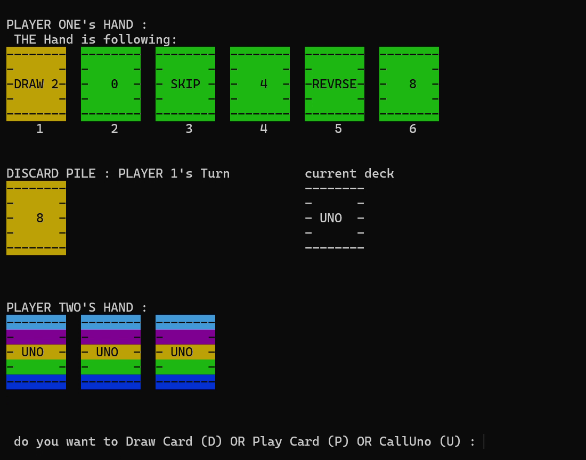

# Console UNO Cards

An academic team project implementing a two-player UNO-style game with coloured Windows-terminal cards and custom data structures.

## Demonstration



A cropped frame from the owner's existing recording. It illustrates the original terminal interface, not a fresh end-to-end test of this revision. No audio is included. [Frame provenance](docs/DEMONSTRATION.md).

## Gameplay and implementation

The implementation models cards with `UnoCard`, a 108-card stack-backed draw deck, linked-list player hands, and a `Game` coordinator. It supports number/colour matching, draw actions, special-card handling, and a call-UNO interaction.

Use the prompted **D/P/U** actions to draw, play, or call UNO; choose cards by their displayed one-based hand positions. Wild colours use **B/G/R/Y**. The existing two-player variant is documented rather than presented as an official rules engine. The draw pile is finite; discard recycling is not implemented. `checking.cpp` is retained as historical supporting work and is not linked into the game.

## Build and run on Windows

The source uses `<windows.h>` and `<conio.h>` for terminal colours/input. Native Linux/macOS compilation is not claimed. Install Visual Studio with the Desktop development with C++ workload and CMake, then run:

```powershell
cmake -S . -B build
cmake --build build --config Release
.\build\Release\console-uno.exe
```

For a single-configuration generator the executable is directly under `build/`. Alternatively, from an x64 Visual Studio Developer Command Prompt:

```bat
cl /nologo /EHsc /std:c++17 /utf-8 Console-UnoCards.cpp /Fe:console-uno.exe
```

Use a wide terminal for the board/card rendering. Build only the entry source named above; compiling every `.cpp` together may include multiple `main` functions.

## Validation and limitations

See [validation notes](docs/VALIDATION.md) for observed build/test results and known limitations. Build success does not establish every game rule as correct. Run focused tests with `cmake --build build --config Debug` and `ctest --test-dir build -C Debug --output-on-failure`. There is no hosted deployment.

## Project context

Academic team project, Programming Fundamentals, FAST-NUCES Islamabad Campus. Syed Muhammad Rayyan Hassan participated in the team; exact feature-by-feature authorship has not been established.
